<div align="center">

<p align="center">
  
</p>

# 🛒 Awesome E-Commerce Intelligence & Inventory Automation

[](https://github.com/ishandutta2007/Awesome-Awesome-Awesome)[](https://discord.gg/jc4xtF58Ve) [](https://github.com/ishandutta2007/Awesome-E-Commerce-Intelligence-Inventory-Automation/pulls) [](LICENSE) [](https://github.com/ishandutta2007)

**A curated, production-ready directory of enterprise SaaS solutions and battle-tested open-source GitHub projects for e-commerce intelligence, competitor price tracking, dynamic repricing, feed syndication, multi-channel inventory synchronization, and demand forecasting.**

</div>

---

## 📑 Table of Contents
- [🔍 Sector Overview & Market Dynamics](#-sector-overview--market-dynamics)
- [💼 Top SaaS & Hosted Platforms](#-top-saas--hosted-platforms)
- [🔓 Battle-Tested Open-Source GitHub Projects](#-battle-tested-open-source-github-projects)
- [🏗️ Architectural Blueprints & Stacks](#-architectural-blueprints--stacks)
- [🤝 How to Contribute](#-how-to-contribute)
- [💖 Support & Sponsorship](#-support--sponsorship)
- [📊 Star History](#-star-history)
- [📜 Disclaimer](#-disclaimer)

---

## 🔍 Sector Overview & Market Dynamics

The global **E-Commerce Intelligence & Analytics** software market is valued at **$18.7B–$21.3B** (expanding at an aggressive **14.1%–21.0% CAGR**), while the specialized **Inventory Management Software (IMS)** market represents **$2.7B–$4.25B** (projected to reach **$9.4B** at an **8.5%–13.1% CAGR**). 

The sector is **moderately fragmented and rapidly consolidating**: enterprise ERP incumbents (Oracle, SAP, Microsoft) anchor core back-office infrastructure, while hyper-specialized SaaS category leaders and agile headless commerce ecosystems fiercely compete across multi-channel feed syndication, algorithmic repricing, and automated Buy Box intelligence.

---

## 💼 Top SaaS & Hosted Platforms

The following hosted platforms provide turnkey market intelligence, automated ad bidding, digital shelf analytics, and multi-channel fulfillment orchestration.

> Products are sorted in **descending order** by company scale (valuation or enterprise acquisition value / revenue run-rate).

| 🏢 Platform | 📝 Overview & Core Features | 💰 Starting Tier Pricing | 🎁 Free Tier / Trial Limits | 📊 Company Scale (Valuation / Revenue) |
| :--- | :--- | :--- | :--- | :--- |
| **[ChannelAdvisor (Rithum)](https://rithum.com)** | Enterprise multi-channel commerce network automating feed syndication, dynamic repricing, digital shelf tracking, and dropship routing across 950+ retail channels. | **$1,000+/mo** (Modular platform license + GMV tiering based on sales volume) | **7-day guided sandbox trial** upon custom sales demo qualification (strictly limited to test product feeds & pilot SKU sync). | **~$665 Million** (Acquired by CommerceHub for ~$665M enterprise value; rebranded as Rithum). |
| **[Sellics (Perpetua)](https://perpetua.io)** | AI-driven marketplace optimization engine unifying programmatic PPC ad management, Amazon keyword harvesting, Buy Box defense, and profit analytics. | **$695/mo** (Essentials Plan; covers up to $10,000 monthly ad spend) | **14-day free trial** with access to automated PPC campaign audit tools & historical benchmark data (capped at 1 Seller Central account). | **~$300 Million ARR / ~$900M Parent EV** (Perpetua acquired by Ascential; now powers Omnicom’s Flywheel commerce arm valued at $900M). |
| **[Feedonomics](https://feedonomics.com)** | Enterprise-grade feed syndication and catalog management solution offering automated data governance, channel tax calculation, and order synchronization. | **$499/mo** (Standard tier based on catalog SKU threshold & channel count) | **14-day limited pilot environment** during sales solution engineering (includes test mapping for up to 100 sample SKUs). | **~$145 Million** (Acquired by BigCommerce for up to $145M cash & stock). |
| **[Helium 10](https://helium10.com)** | Comprehensive Amazon & Walmart merchant intelligence suite featuring reverse-ASIN keyword scraping, listing scorecards, competitor alerts, and inventory restock forecasting. | **$99/mo** (Platinum Plan; billed annually or $129/mo billed monthly) | **Forever Free Plan** (Lifetime caps: 5 uses for Black Box product finder, 10 uses for Xray extension; 2 searches/mo Listing Analyzer; 2 ASINs tracked for Alerts; 30-day access to Inventory Profits). | **$100M+ ARR / $1B+ Parent Scale** (Flagship asset of Assembly / Pacvue, backed by Providence Strategic Growth & Advent International at $1B+ valuation). |
| **[Teikametrics](https://teikametrics.com)** | Generative AI marketplace optimization and algorithmic bidding platform (*ARI*) for automated keyword harvesting, Amazon DSP advertising, and cross-channel inventory alerts. | **$149/mo** (Essentials Plan; supports up to $10,000 monthly ad spend across Amazon & Walmart) | **30-day free trial** of Essentials tier (includes automated PPC bid optimization, keyword harvest automation, and sales dashboard access). | **~$65M Total Funding / ~$50M ARR** (Series B led by Intel Capital, GoDaddy, Centana Growth Partners, and Jump Capital). |
| **[ChannelEngine](https://channelengine.com)** | Global marketplace integration middleware synchronizing catalogs, localized currencies, stock balances, and return workflows across 950+ international channels. | **€499/mo** (Starter tier license + incremental GMV success fee above baseline) | **14-day free trial** for sandbox marketplace integration (restricted to 2 sales channels and 500 catalog SKUs). | **~$57.4M Total Funding / ~$46.8M ARR** (Series B funded by Atomico, General Catalyst, Inkef, and Airbridge Equity Partners). |
| **[Jungle Scout](https://junglescout.com)** | Gold-standard Amazon product intelligence tool offering real-time sales estimation, opportunity discovery, supplier directories, and automated review requests. | **$29/mo** (Starter Plan billed annually at $348/yr, or $49/mo billed monthly) | **7-day risk-free money-back guarantee** on paid plans + free single-ASIN browser sales estimator widget (zero software licensing fees during 7-day guarantee). | **~$110M Growth Equity / ~$40M ARR** (Growth investment from Summit Partners; manages over $8B+ in merchant GMV). |
| **[Keepa](https://keepa.com)** | Unrivaled Amazon price history tracking service, live sales rank monitor, and deal-notification engine with extensive raw historical pricing APIs. | **€19/mo** (Web Data Access) / **€49/mo** (Keepa Developer API Starter Plan) | **Forever Free Extension Tier** (Free access to embedded 90-day price history graphs on Amazon; API requires minimum €49/mo tier for 20 tokens/minute). | **~$15M+ ARR** (Bootstrapped, highly profitable industry-standard infrastructure provider querying 5+ billion products). |
| **[SellerApp](https://sellerapp.com)** | E-commerce growth management software pairing predictive ad optimization algorithms with digital shelf monitoring, sales analytics, and ASIN indexing diagnostics. | **$39/mo** (Pro-Lite Plan billed annually, or $49/mo billed monthly) | **Forever Free Plan** (Track up to 2 products, perform 3 daily search queries, with 7-day full-feature trial on paid plans). | **~$8M–$12M ARR / Venture-backed** (Private institutional seed & angel backing; tracking over $1B+ in merchant ad & catalog volume). |

---

## 🔓 Battle-Tested Open-Source GitHub Projects

Deploying open-source software avoids expensive GMV revenue-share taxes while giving enterprise developers complete control over data sovereignty, custom repricing logic, and bespoke warehouse automation workflows.

> All repositories are sorted in **descending order** by GitHub stars count. Click the star badge to visit the repo's stargazers!

| 📦 Repository & Project | ⭐ Stars Badge | 🛠️ Technology Stack | 🎯 Core Capabilities & Use Cases |
| :--- | :--- | :--- | :--- |
| **[n8n (`n8n-io/n8n`)](https://github.com/n8n-io/n8n)** | [](https://github.com/n8n-io/n8n/stargazers) | TypeScript / Node.js | Fair-code workflow automation engine with 400+ native connectors. Ideal for orchestrating multi-channel stock syncs, low-inventory Slack/email triggers, Shopify/WooCommerce webhooks, and ERP restock loops. |
| **[Playwright (`microsoft/playwright`)](https://github.com)** | [](https://github.com/microsoft/playwright/stargazers) | Node.js / Python / Go | Resilient headless browser automation library with auto-waiting, network interception, and stealth execution for live competitor price scraping, Buy Box monitoring, and dynamic web extraction. |
| **[Apache Superset (`apache/superset`)](https://github.com/apache/superset)** | [](https://github.com/apache/superset/stargazers) | Python / TypeScript | Enterprise-grade business intelligence and data exploration platform. Powers executive dashboards for real-time SKU velocity, gross margin calculations, ad ROAS, and inventory replenishment forecasting. |
| **[Strapi (`strapi/strapi`)](https://github.com/strapi/strapi)** | [](https://github.com/strapi/strapi/stargazers) | TypeScript / Node.js | Extensible headless Content Management System (CMS) widely customized for catalog syndication, product storytelling, structured media distribution, and omnichannel localized pricing schemas. |
| **[NocoDB (`nocodb/nocodb`)](https://github.com/nocodb/nocodb)** | [](https://github.com/nocodb/nocodb/stargazers) | TypeScript / Vue.js | Open-source Airtable alternative turning PostgreSQL/MySQL databases into smart collaborative spreadsheets. Perfect for catalog enrichment, supplier directories, and manual purchase order validation. |
| **[Scrapy (`scrapy/scrapy`)](https://github.com/scrapy/scrapy)** | [](https://github.com/scrapy/scrapy/stargazers) | Python / Twisted | Fast, high-throughput web crawling framework for harvesting millions of e-commerce product pages, tracking market price fluctuations, and catalog indexing at internet scale. |
| **[Meilisearch (`meilisearch/meilisearch`)](https://github.com/meilisearch/meilisearch)** | [](https://github.com/meilisearch/meilisearch/stargazers) | Rust | Lightning-fast, typo-tolerant search and merchandising engine designed for sub-50ms catalog lookups, faceted SKU filtering, real-time stock-state querying, and merchant boost rules. |
| **[Odoo Community (`odoo/odoo`)](https://github.com/odoo/odoo)** | [](https://github.com/odoo/odoo/stargazers) | Python / JavaScript | Comprehensive open-source ERP system featuring automated double-entry inventory control, multi-warehouse routing, automated purchase reorder triggers, and third-party marketplace connectors. |
| **[Metabase (`metabase/metabase`)](https://github.com/metabase/metabase)** | [](https://github.com/metabase/metabase/stargazers) | Clojure / TypeScript | Intuitive business intelligence and reporting platform allowing non-technical retail teams to query inventory burn rates, stockout risks, and cross-channel marketing margins. |
| **[ERPNext (`frappe/erpnext`)](https://github.com/frappe/erpnext)** | [](https://github.com/frappe/erpnext/stargazers) | Python / JavaScript | 100% open-source enterprise ERP equipped with serialized stock tracking, multi-location inventory valuations (FIFO/Moving Average), automated purchase orders, and multi-channel order routing. |
| **[Directus (`directus/directus`)](https://github.com/directus/directus)** | [](https://github.com/directus/directus/stargazers) | TypeScript / Node.js | Real-time data engine providing instant REST and GraphQL APIs on any SQL database. Frequently used to build internal seller portals, custom SKU management tools, and headless PIM interfaces. |
| **[Medusa (`medusajs/medusa`)](https://github.com/medusajs/medusa)** | [](https://github.com/medusajs/medusa/stargazers) | TypeScript / Node.js | Modular, headless digital commerce engine featuring multi-warehouse inventory allocation, custom pricing logic, localized sales channels, and pluggable order fulfillment automation. |
| **[Changedetection.io (`dgtlmoon/changedetection.io`)](https://github.com/dgtlmoon/changedetection.io)** | [](https://github.com/dgtlmoon/changedetection.io/stargazers) | Python / Playwright | Self-hosted web change monitoring platform. Tracks competitor price fluctuations, Buy Box shifts, restock alerts, and page alterations via CSS/XPath/JSON selectors with notification hooks. |
| **[Hasura GraphQL (`hasura/graphql-engine`)](https://github.com/hasura/graphql-engine)** | [](https://github.com/hasura/graphql-engine/stargazers) | Haskell / Go | Blazing-fast GraphQL and REST API layer on top of PostgreSQL/MySQL/BigQuery. Unifies distributed retail databases, ERP tables, and microservices for low-latency inventory querying. |
| **[Bagisto (`bagisto/bagisto`)](https://github.com/bagisto/bagisto)** | [](https://github.com/bagisto/bagisto/stargazers) | PHP / Laravel | Open-source e-commerce platform offering native multi-inventory source allocation, multi-currency support, B2B marketplaces, and automated order fulfillment pipelines. |
| **[Typesense (`typesense/typesense`)](https://github.com/typesense/typesense)** | [](https://github.com/typesense/typesense/stargazers) | C++ | Blazing-fast open-source search engine optimized for developer-friendly catalog filtering, real-time in-stock filtering, geo-search, and retail merchandising rules. |
| **[Crawlee (`apify/crawlee`)](https://github.com/apify/crawlee)** | [](https://github.com/apify/crawlee/stargazers) | TypeScript / Python | Scalable scraping and browser automation library with built-in proxy rotation, session management, fingerprint spoofing, and request queueing for extracting protected marketplace pricing. |
| **[Activepieces (`activepieces/activepieces`)](https://github.com/activepieces/activepieces)** | [](https://github.com/activepieces/activepieces/stargazers) | TypeScript | Modern open-source workflow automation platform with visual builders and native marketplace connectors for synchronizing SKU balances, trigger-based price alerts, and customer notifications. |
| **[Saleor (`saleor/saleor`)](https://github.com/saleor/saleor)** | [](https://github.com/saleor/saleor/stargazers) | Python / Django / GraphQL | High-performance, headless commerce engine built for global retail brands. Features multi-warehouse stock reservation, multi-channel pricing rules, and webhook-driven fulfillment architecture. |
| **[Airbyte (`airbytehq/airbyte`)](https://github.com/airbytehq/airbyte)** | [](https://github.com/airbytehq/airbyte/stargazers) | Java / Python | Leading open-source ELT data pipeline platform. Replicates data from Shopify, Amazon Ads, Stripe, Facebook Ads, and ERPs into central data warehouses (BigQuery, Snowflake, ClickHouse, DuckDB). |
| **[Prophet (`facebook/prophet`)](https://github.com/facebook/prophet)** | [](https://github.com/facebook/prophet/stargazers) | Python / R | Time-series forecasting procedure designed for handling seasonal SKU sales trends, holiday promotions, demand spikes, and safety-stock replenishment calculations. |
| **[Spree Commerce (`spree/spree`)](https://github.com/spree/spree)** | [](https://github.com/spree/spree/stargazers) | Ruby on Rails | Modular open-source commerce platform supporting multi-location inventory tracking, automated stock splits across fulfillment centers, and headless API operations. |
| **[Snipe-IT (`grokability/snipe-it`)](https://github.com/grokability/snipe-it)** | [](https://github.com/grokability/snipe-it/stargazers) | PHP / Laravel | Trusted open-source inventory and asset tracking platform featuring QR/barcode generation, audit logging, asset allocation, and REST API triggers for warehouse operations. |
| **[Palmier Pro (`palmier-io/palmier-pro`)](https://github.com/palmier-io/palmier-pro)** | [](https://github.com/palmier-io/palmier-pro/stargazers) | TypeScript / Python | Specialized e-commerce intelligence and operations toolkit engineered for marketplace analytics, catalog quality auditing, and cross-channel automation. |
| **[UnoPim (`unopim/unopim`)](https://github.com/unopim/unopim)** | [](https://github.com/unopim/unopim/stargazers) | PHP / Laravel | Modern, lightweight open-source Product Information Management (PIM) system for structuring, enriching, translating, and exporting multi-channel catalog feeds. |
| **[Grocy (`grocy/grocy`)](https://github.com/grocy/grocy)** | [](https://github.com/grocy/grocy/stargazers) | PHP / SQLite | Self-hosted ERP-style inventory manager featuring barcode scanning, lot tracking, minimum stock thresholds, stock consumption analytics, and webhook automation. |
| **[Darts (`unit8co/darts`)](https://github.com/unit8co/darts)** | [](https://github.com/unit8co/darts/stargazers) | Python | User-friendly Python library for time series forecasting with deep learning (TFT, N-BEATS, TiDE) and statistical models for retail demand forecasting and stock replenishment. |
| **[Vendure (`vendure-ecommerce/vendure`)](https://github.com/vendure-ecommerce/vendure)** | [](https://github.com/vendure-ecommerce/vendure/stargazers) | TypeScript / GraphQL | Headless commerce framework built with NestJS. Supports multi-channel catalog structures, stock location strategies, dynamic price calculation strategies, and event hooks. |
| **[InvenTree (`inventree/InvenTree`)](https://github.com/inventree/InvenTree)** | [](https://github.com/inventree/InvenTree/stargazers) | Python / Django | Robust, modular open-source inventory management system with stock tracking, supplier management, bill-of-materials (BOM), barcode scanning, and REST API endpoints. |
| **[Streetmerchant (`jef/streetmerchant`)](https://github.com/jef/streetmerchant)** | [](https://github.com/jef/streetmerchant/stargazers) | TypeScript / Node.js | Self-hosted automated inventory restock bot and price tracking engine designed to scan major retail storefronts and alert immediately via Discord, Telegram, or webhooks. |
| **[Pimcore Community (`pimcore/pimcore`)](https://github.com/pimcore/pimcore)** | [](https://github.com/pimcore/pimcore/stargazers) | PHP / Symfony | Open-source enterprise data platform unifying PIM, Master Data Management (MDM), Digital Asset Management (DAM), and multi-channel feed export engines for massive product catalogs. |
| **[Meltano (`meltano/meltano`)](https://github.com/meltano/meltano)** | [](https://github.com/meltano/meltano/stargazers) | Python | Declarative, code-first data integration engine (Singer-based ELT). Simplifies pulling orders, inventory logs, and ad metrics into data lakes with version-controlled YAML. |
| **[Part-DB (`Part-DB/Part-DB-server`)](https://github.com/Part-DB/Part-DB-server)** | [](https://github.com/Part-DB/Part-DB-server/stargazers) | PHP / Symfony | Web-based stock and inventory manager featuring multi-location warehouse bin mapping, barcode printing, price tier tracking, and supplier ordering histories. |
| **[Akeneo PIM Community (`akeneo/pim-community-dev`)](https://github.com/akeneo/pim-community-dev)** | [](https://github.com/akeneo/pim-community-dev/stargazers) | PHP / Symfony | Industry-standard open-source PIM system enabling retail brands to clean, enrich, localize, and syndicate high-volume product catalogs across marketplaces. |
| **[OpenBoxes (`openboxes/openboxes`)](https://github.com/openboxes/openboxes)** | [](https://github.com/openboxes/openboxes/stargazers) | Java / Groovy | Enterprise-grade open-source supply chain and warehouse management system (WMS) built to manage stock movement, cold-chain tracking, lot numbers, and purchase orders across global distribution hubs. |
| **[Discount Bandit (`Cybrarist/Discount-Bandit`)](https://github.com/Cybrarist/Discount-Bandit)** | [](https://github.com/Cybrarist/Discount-Bandit/stargazers) | Python | Lightweight e-commerce price monitoring bot with automatic discount notifications, price-drop thresholds, and automated alerting channels. |
| **[Python Amazon SP-API (`saleweaver/python-amazon-sp-api`)](https://github.com/saleweaver/python-amazon-sp-api)** | [](https://github.com/saleweaver/python-amazon-sp-api/stargazers) | Python | Production-grade Python wrapper for Amazon Selling Partner API. Enables programmatic access to real-time pricing feeds, FBA inbound inventory, order status, and catalog listings. |

---

## 🏗️ Architectural Blueprints & Stacks

Modern retail data teams build robust, unmetered self-hosted intelligence stacks by composing open-source tools:

```text
┌────────────────────────────────────────────────────────────────────────┐
│                   E-Commerce Intelligence Stack                        │
├──────────────────┬──────────────────┬─────────────────┬────────────────┤
│ 1. DATA CRAWL    │ 2. PIPELINES     │ 3. ANALYTICS    │ 4. EXECUTION   │
│ Scrapy / Crawlee │ Airbyte /        │ Superset /      │ n8n / Medusa / │
│ Playwright       │ Meltano / Kafka  │ Metabase /      │ SP-API REST    │
│ (Price Scraping) │ (ELT & Database) │ Prophet (Demand)│ (Repricing)    │
└──────────────────┴──────────────────┴─────────────────┴────────────────┘
```

1. **Scrape & Track**: Monitor competitor product pricing, stock availability, and Buy Box ownership using `Playwright` or `Crawlee`.
2. **Synchronize & Extract**: Pipeline sales metrics and inventory ledger updates across channels with `Airbyte` into a centralized PostgreSQL/ClickHouse warehouse.
3. **Forecast & Predict**: Generate SKU safety-stock thresholds and restock runouts using `Prophet` or `Darts`.
4. **Automate & Push**: Trigger restock purchase orders and push automated repricing updates back to Shopify, Amazon, and marketplaces via `n8n` and `python-amazon-sp-api`.

---

## 🤝 How to Contribute

Contributions are welcome! Please follow these guidelines:

1. 🍴 **Fork** this repository.
2. 🌿 **Create a branch**: `git checkout -b feature/new-tool`
3. 📝 **Add your project** in alphabetical or star-ranked order to the appropriate section:
   - For **SaaS products**: include name, URL, short description, specific starting price, explicit free tier limits, and company scale metric.
   - For **Open-Source projects**: include repo handle (`org/repo`), official link, tech stack, star badge, and clear description.
4. 🚀 **Submit a Pull Request** with a concise description of why the tool should be added.

---

## 💖 Support & Sponsorship

If you find this curated collection helpful for your e-commerce operations, research, or development stack, please consider supporting the project:

- ⭐ **Star this repository** to help others discover it!
- 🍴 **Fork and share** with your e-commerce engineering and data teams.
- ☕ **Sponsor the Maintainer**: Buy a coffee and support open-source maintenance on the [GitHub Sponsor Dashboard](https://github.com/sponsors/ishandutta2007)!

---

## 📊 Star History

[](https://www.star-history.com/#ishandutta2007/Awesome-E-Commerce-Intelligence-Inventory-Automation&type=date&legend=top-left)

---

## 📜 Disclaimer

- **Community Curated**: This is a community-driven repository curated for informational and technical engineering reference; inclusion does not constitute a commercial endorsement.
- **Terms of Service Compliance**: Data collection and web scraping should always respect target platforms' robots.txt, rate limits, APIs, and legal terms of service.
- **Repricing Safeguards**: Always configure safety bounds (hard pricing floors and ceilings) when enabling automated algorithmic repricing to prevent margin loss.

---

<div align="center">
  <sub>Curated with ❤️ by <a href="https://github.com/ishandutta2007">Ishan Dutta</a> and the global e-commerce open-source community.</sub>
</div>
